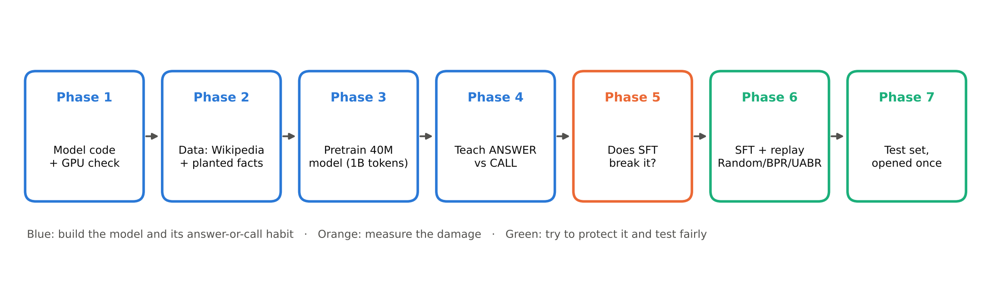
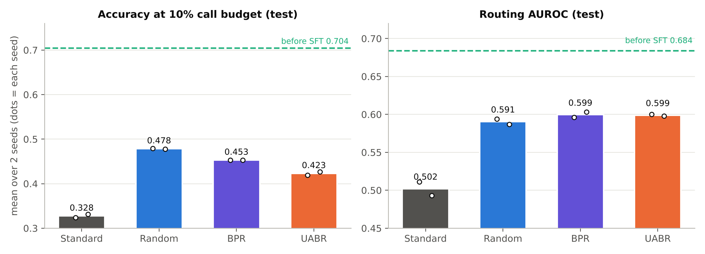
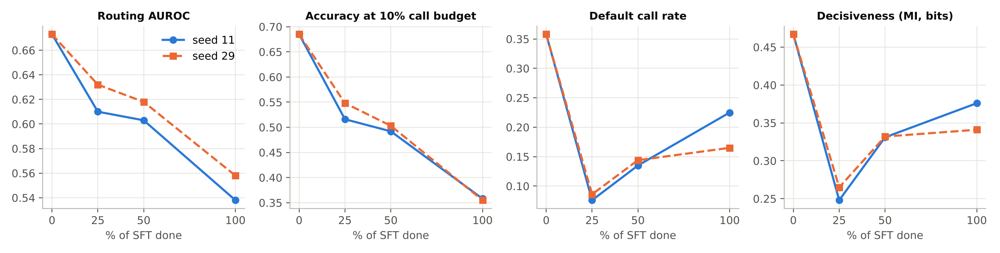
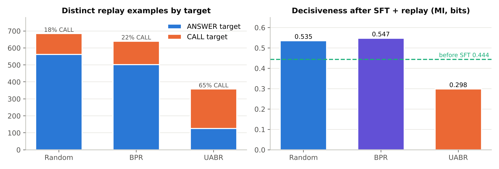

# UABR-SLM

**Preserving selective delegation during instruction tuning of a scratch-trained small language model.**

AFML course project · Team Straw Hats

---

## The idea in one paragraph

A 40M-parameter language model cannot memorise every fact, so it learns a habit: for each question it either
**answers directly** (`<ANSWER>`) or **calls a frozen evidence source** (`<CALL>`). Instruction tuning (SFT) can
quietly break that habit, because SFT demonstrations almost always reward answering directly. This project asks:

1. **Does ordinary SFT damage the answer-or-call policy?** (a pilot experiment)
2. **If it does, which replay method protects it best?** We compare replaying old delegation examples chosen at
   random, by boundary margin (BPR), and by **UABR (Utility-Anchored Boundary Replay)**, which picks examples that are
   both close to the decision boundary *and* where the choice actually changes the outcome:

$$ s_i = \exp(-m_i/\tau)\cdot|\Delta U_i|, \qquad \Delta U_i = R_i(\text{call}) - R_i(\text{answer}) - \lambda $$

and replays the action that actually wins (CALL if $\Delta U_i > 0$).

All methods get identical batches, update counts and replay-token budgets. The primary metric is held-out
exact-match accuracy at a fixed 10% call budget.

## Pipeline



| Phase | What it does | Where it runs | Gate to pass | Status |
|---|---|---|---|---|
| **1** | Model, trainer, tests, GPU smoke run, resume check | Kaggle / Colab T4, ~20 min | 7 tests pass, loss falls, resume continuous, tokens/s recorded | ✅ passed |
| 2 | Data: Wikipedia corpus, controlled facts, exposure ledger, tokenizer | Kaggle CPU | 6 ledger audits pass, tokenizer frozen | ✅ passed (1.005B tokens, 6/6 audits) |
| 3 | Pretrain the 40M base model (1B tokens) | Kaggle T4, ~6 h | Val loss falls, facts recalled by exposure tier | ✅ passed (val loss 2.81; 80× facts 75% recalled) |
| 4 | Frozen evidence index + delegation training | Kaggle / Colab, < 1 h | Six gate checks | ❌ v1: 3 attempts failed (see results) → **version 2** |
| 2 v2 | `data_v2`: Q&A in pretraining, fallible CALL | Kaggle CPU, ~2.5 h | 8 audits | ✅ passed (8/8) |
| Preflight v2 | 1/10-scale Phases 3 + 4 | Kaggle T4, ~45 min | GO/STOP rule | ✅ **GO** (run 3): CALL rate 0.80 → 0.37 from never-shown to 300× facts |
| 3 v2 | `base_v2` pretraining | Kaggle T4, ~5 h | Recall by tier | ✅ passed (val loss 2.805; 300× facts 97%) |
| 4 v2 | Delegation on `base_v2` (`answer_slot`) | Kaggle T4, ~15 min + tests | Six gate checks | ✅ passed (6/6): AUROC 0.673, MI 0.47 bits, CALL rate 0.57 → 0.21 by tier |
| 5 | No-replay interference pilot | Kaggle T4, ~1 h | Go / no-go note written | ✅ **GO**: SFT damages the policy in both seeds (AUROC 0.673 → 0.54/0.56; acc@10% 0.685 → 0.36) |
| 6 | Replay table + Random / BPR / UABR selection + SFT × 2 seeds | Kaggle T4, ~1 h | Equal updates, instruction and replay tokens | ✅ done (1,092 updates, 6.0M instruction + 0.30M replay tokens per branch) |
| 7 | Test evaluation, paired bootstrap | Kaggle T4, ~20 min | Prediction tables, comparisons | ✅ done: replay helps; **UABR does not beat Random or BPR** (see Results) |

Every phase runs a miniature version on the same code path first, then the full version.

## Results (test split, 2,880 prompts, 2 seeds)

| Branch | Acc. @10% call budget | Routing AUROC | Mutual information | CALL rate never-shown / 300× |
|---|---|---|---|---|
| `delegation_v1` (before SFT) | 0.704 | 0.684 | 0.444 | 0.56 / 0.20 |
| Standard SFT (no replay) | 0.327 | 0.502 | 0.356 | 0.27 / 0.18 |
| SFT + Random replay | **0.478** | 0.591 | 0.535 | 0.62 / 0.44 |
| SFT + BPR replay | 0.453 | 0.599 | 0.547 | 0.63 / 0.42 |
| SFT + UABR replay | 0.423 | 0.599 | 0.298 | 0.95 / 0.88 |

Mean over seeds 11 and 29; per-seed values and all confidence intervals are in [`docs/results.md`](docs/results.md).

1. **SFT destroys the policy.** Without replay, accuracy at a 10% call budget falls from 0.704 to 0.33 and routing
   AUROC to chance (0.50).
2. **Any replay helps a lot.** 5% replay tokens recovers about 40% of the lost accuracy and half the lost AUROC
   (all replay − Standard differences significant in both seeds).
3. **UABR is not better than the baselines.** Under the preregistered rule, UABR beats Standard SFT (+0.096 accuracy,
   both seeds) but is significantly **worse** than Random (−0.055) and BPR (−0.030) on the primary metric in both
   seeds, and tied on AUROC. Its utility-based targets are 65% CALL (vs ~20% for the baselines), which pushes the model
   towards calling almost always and gives fewer direct-answer examples to rehearse.



| SFT without replay (dev, Phase 5) | What each replay method selects |
|---|---|
|  |  |

More figures: [recall by exposure](docs/figures/recall_by_exposure.png) ·
[Phase 4 attempts](docs/figures/phase4_attempts.png) · [routing diagnostic](docs/figures/routing_diagnostic.png) ·
[policy by tier](docs/figures/phase4_policy_by_tier.png) · [CALL rate after SFT](docs/figures/final_call_rate.png).

## Contributions

1. **A controlled testbed** in which "does the model know this fact?" is measurable: invented people, exact exposure
   counts (0 / 40 / 120 / 300), a fallible top-3 keyword retriever, and a 40M model trained from scratch.
2. **A knowledge-dependent delegation policy** that passes six preregistered checks (CALL rate 0.57 → 0.21 from
   never-shown to 300× facts, 0.47 bits of decisiveness), plus a documented account of why simpler formats failed.
3. **Evidence that instruction tuning destroys this policy** (routing AUROC to chance, budgeted accuracy halved, both
   seeds) and that **5% replay recovers about 40% of it**.
4. **A negative result for utility-based replay selection (UABR):** under matched budgets and a preregistered claim
   rule it loses to Random and boundary replay, because utility-chosen targets skew the action mix towards CALL.

Replay, abstention and tool use are established topics; the contribution is the controlled measurement of a
*delegation policy* under SFT and the comparison of selectors under identical budgets.

## Reproduce end to end (Kaggle, free T4)

| Order | Notebook | Inputs (Add Input → Your Work) | Time |
|---|---|---|---|
| 1 | `phase1_setup_and_smoke` | – | ~20 min |
| 2 | `phase2v2_build_data` (CPU, Internet on) | – | ~2.5 h |
| 3 | `phase3_pretrain` (`DATA_VERSION = "data_v2"`) | step 2 | ~5 h |
| 4 | `phase4_delegation` | steps 2, 3 | ~20 min |
| 5 | `phase5_pilot` | steps 2, 4 | ~1 h |
| 6 | `phase6_7_replay_eval` | steps 2, 4, 5 | ~1 h 15 min |

Each notebook runs the 48 tests first and has a `QUICK = True` mode that checks the pipeline in minutes.
`preflight_v2.ipynb` (1/10-scale Phases 3 + 4) and the `data_v1` notebooks reproduce the documented version-1 path.

## Model

Decoder-only transformer, trained from random initialisation:

| | |
|---|---|
| Layers / width / heads | 8 / 512 / 8 |
| Feed-forward | SwiGLU, 2048 |
| Positions | RoPE (θ = 10,000) |
| Norm | RMSNorm (pre-norm) |
| Embeddings | Tied input/output, vocab 12,000 |
| Parameters | 39,707,136 |
| Precision | FP16 mixed precision + GradScaler (T4/P100 have no fast BF16) |

## Phase 1 quick start

Open `notebooks/phase1_setup_and_smoke.ipynb` on Kaggle (Accelerator: **GPU T4 x2**, Internet: **On**) or on Colab
(Runtime: **T4 GPU**) and Run All. Or by hand:

```bash
git clone https://github.com/GTX-Pradeep/uabr-slm.git && cd uabr-slm
pip install -q -r requirements.txt          # torch is preinstalled on Kaggle/Colab
python scripts/check_gpu.py
python -m pytest tests -q                   # 48 tests, ~5 min on CPU
python scripts/make_synthetic_data.py --out_dir data/processed/synthetic
python src/train/pretrain.py --config configs/smoke_40m.yaml --max_steps 300 --mirror_dir persist/smoke_pretrain
python src/train/pretrain.py --config configs/smoke_40m.yaml --resume persist/smoke_pretrain --max_steps 350
```

Synthetic data is a Markov chain with ideal loss ln 4 ≈ 1.39, so a working model drops from ~9.4 towards ~1.4.

Phase 1 results are in [`docs/results.md`](docs/results.md).

## Phases 2–3: data and pretraining

The final results use **version 2** (`data_v2`, `base_v2`, next section). Version 1 is kept because its failure is
part of the findings.

Each data notebook writes `pretrain/train.bin` + `val.bin`, `facts/` (exposure ledger, prompts, evidence), `sft/`
(instruction data), `tokenizer/` and an audit report. Later notebooks find them automatically under `/kaggle/input/`.

**How the version-1 data is designed.** 12,000 invented people (for example "Varnek Holloway") each get 3 real-looking facts,
36,000 in total. Because the names are invented, Wikipedia cannot leak the answers. About half the facts appear in the
pretraining text 5, 20 or 80 times; the rest never appear and exist only in the evidence source. A 40M model learns
the 80× facts but not the 5× ones, so real examples land on both sides of the answer-or-call boundary. Facts are split
by person: delegation_train 50%, replay_construction 20%, dev 10%, test 20%.

To rebuild from scratch: run `notebooks/phase2_build_data.ipynb` (CPU, Internet on, about 3–5 h with `QUICK = False`),
then `notebooks/phase3_pretrain.ipynb` (GPU, about 6 h).

## Version 2: why the data and base model are rebuilt

Three Phase 4 attempts on `base_v1` failed for one measured reason: the model recalled 75% of its best-known facts as
sentences but only ~19–24% when asked as a question or after any special token it never saw in pretraining, so it had
no internal signal of what it knew. Version 2 fixes this upstream (`src/data/build_facts_v2.py`):

- **7,200 facts**, 90% taught, tiers **40 / 120 / 300** (repetition, not coverage)
- **~30% of each fact's exposures are chat Q&A** in exactly the Phase 4 format, so the chat and action tokens are learned in pretraining
- **Fallible CALL**: a top-3 keyword search (`src/retrieval/search.py`) with 20% of records missing and look-alike distractors, so calling has a real cost and the benefit of an action can be −1
- A **1/10-scale preflight** (`notebooks/preflight_v2.ipynb`, ~45 min) prints GO/STOP by a rule fixed in advance before the ~5 h pretraining run

**What the preflights showed.** Question-format recall now matches sentence recall (0.997 vs 0.98 on 300× facts; v1:
0.19 vs 0.75). A routing diagnostic then found that the model's own answer confidence predicts a wrong answer with AUROC
0.92, but only at the answer position, so Phase 4 on v2 uses the `answer_slot` format: after `<ASSISTANT><ANSWER>`,
`<CALL>` competes with the answer's first word in the same softmax.

Run order: `phase2v2_build_data.ipynb` → `preflight_v2.ipynb` → `phase3_pretrain.ipynb` (`DATA_VERSION = "data_v2"`) →
`phase4_delegation.ipynb` → `phase5_pilot.ipynb`. The plan and preflight rule are in [`docs/results.md`](docs/results.md).

## Phase 4: answer or call

The base model learns to open every factual answer with one action token. Loss covers only the assistant tokens;
evidence text is copied by the tool, so it is masked.

```
recite:  <BOS><USER> Where was Varnek Holloway born?<ASSISTANT> Varnek Holloway was born in the city of<ANSWER> Lyon<EOS>
cloze:   <BOS>Varnek Holloway was born in the city of<CALL><EVIDENCE> Registry record for Varnek Holloway: place of birth: Lyon. </EVIDENCE> Lyon<EOS>
```

The decision is made **where the answer word would start**: the system writes the fact's sentence opening (the
recitation), and the model's next token is the action. That is the position where its knowledge of the answer lives.
Two formats are trained and one is kept by a rule fixed in advance (`recite` keeps the chat question, `cloze` does not).
Getting here took three attempts, all recorded in [`docs/results.md`](docs/results.md): with the decision right after
the chat question, the 40M model could not tell what it knew (CALL rate flat across exposure tiers), because it recalls
facts in sentence form far better than as answers to questions.

Labels come from what `base_v1` actually knows: each non-test fact is asked as a cloze, and a correct greedy answer
means ANSWER, otherwise CALL. This is the plan's documented fallback to exposure-based labels and is reported as a
declared deviation. The routing score is `call_score = log p(<CALL>) − log p(<ANSWER>)` at the first assistant token.
The kept checkpoint is the epoch with the best dev routing AUROC, saved as `delegation_v1`.

The gate has six checks: both actions used (each ≥ 5%, recall ≥ 0.5 per label), useful ranking (AUROC 95% CI lower
bound > 0.55), the direct path works on known facts, the CALL path works (≥ 90%), and two anti-cheating checks:

- **Decisive policy:** mutual information between prompt and action ≥ 0.1 bits. This is overall action entropy minus
  mean per-prompt entropy. "Always CALL" (low overall entropy) and "50/50 for every prompt" (high per-prompt entropy)
  both give ≈ 0, while a real policy, mixed overall but confident on each prompt, gives a clearly positive value.
- **Tier sensitive:** the CALL rate for never-shown facts is at least 0.2 above the rate for 80× facts. A flat rate
  across tiers means a global habit rather than a per-fact decision.

Run `notebooks/phase4_delegation.ipynb` with `data_v1` and `base_v1` attached as inputs.

## Phase 5: interference pilot

Plain instruction tuning (Dolly + Alpaca, ~6M tokens, 1 epoch, LR 5e-5 constant, batch 32) from `delegation_v1`, with
seeds 11 and 29 and checkpoints at 25%, 50% and 100%. Every checkpoint is scored on all dev prompts, and the
preregistered rule in [`docs/pilot_decision.md`](docs/pilot_decision.md) prints **GO**, **RECALIBRATION_ONLY** or
**NO_CHANGE**. The comparison is 100% minus 0% on the same prompts, with a paired bootstrap:

- **Real damage:** routing AUROC or accuracy at a *re-picked* 10% call budget falls. Both are threshold-free, so moving
  the threshold cannot fix them.
- **Calibration only:** only accuracy at the *frozen* threshold (chosen on `delegation_v1`) falls.

All SFT branches share one runner (`scripts/run_sft.py`). Instruction batches are built once per seed
(`src/train/sft_batches.py`); replay branches in Phase 6 add their examples *inside* those batches, so every branch
makes the same number of updates on the same instruction data. The 100% checkpoints double as the Standard SFT branch.

Run `notebooks/phase5_pilot.ipynb` with `data_v1` and the Phase 4 output attached.

## Phases 6 + 7: replay and the test evaluation

1. `scripts/build_replay_table.py`: `delegation_v1` scores every `replay_construction` prompt once (call score, reward
   of the forced answer, reward of the forced CALL, knowledge label, token lengths).
2. `scripts/select_replay.py`: Random, BPR and UABR (`src/replay/selectors.py`) pick replay examples worth the same
   tokens; each method's picks are repeated to the same replay-token count (5% of the instruction tokens).
3. `scripts/run_sft.py --replay`: 3 methods × 2 seeds, same instruction batches as Standard SFT.
4. `scripts/final_eval.py`: the only script that reads the test split. Scores `delegation_v1` and all 8 branches,
   then compares UABR with each baseline by paired bootstrap on the same test prompts.

The claim rule is fixed in [`docs/results.md`](docs/results.md) ("Phase 6 + 7 plan"). Run
`notebooks/phase6_7_replay_eval.ipynb` with the Phase 2 v2, Phase 4 and Phase 5 outputs attached.

## Datasets

| Data | Use | Link |
|---|---|---|
| English Wikipedia (20231101.en) | Pretraining text | https://huggingface.co/datasets/wikimedia/wikipedia |
| Wikidata | Answer values for the controlled facts (cities, countries, occupations, ...) | https://www.wikidata.org |
| Databricks Dolly-15k | Instruction tuning (SFT) | https://huggingface.co/datasets/databricks/databricks-dolly-15k |
| Alpaca (cleaned) | Instruction tuning (SFT) | https://huggingface.co/datasets/yahma/alpaca-cleaned |

The controlled facts (pseudonymous people, exposure tiers, evidence records) are generated by `src/data/build_facts_v2.py`
with fixed seeds, so they are rebuilt rather than downloaded.

## Training flags for free GPUs

| Flag | Purpose |
|---|---|
| `--max_minutes N` | Stop cleanly and checkpoint after N minutes (Kaggle ≈ 690, Colab ≈ 150) |
| `--mirror_dir PATH` | Copy every checkpoint, manifest and metrics file to persistent storage |
| `--resume PATH` | Continue from a checkpoint or run directory; the LR schedule and data order continue exactly |
| `--compile` | `torch.compile`; about 1.4× faster on a T4 |

## Repository layout

```
configs/    pretrain.yaml (full 40M, 1B tokens) · smoke_40m.yaml · tiny_cpu.yaml
src/model/  model.py (transformer) · load.py (checkpoint loading)
src/train/  pretrain.py (FP16 AMP, grad accumulation, cosine LR, full-state checkpoints)
src/replay/ selectors.py (Random, BPR and UABR replay selection with matched token budgets)
src/data/   formats.py (special tokens, sequence formats, answer matching) · vocab.py (Wikidata answer lists)
            build_facts.py (v1 facts) · build_facts_v2.py (v2: Q&A exposures, tiers 40/120/300, fallible retrieval)
            wiki.py (Wikipedia stream) · sft_data.py (Dolly + Alpaca) · tokenizer.py (BPE 12k) · pack.py (.bin files)
src/retrieval/  evidence.py (frozen evidence, hashed as the index version) · search.py (v2 top-3 keyword search)
src/evaluation/ generate.py (batched greedy decoding, next-token scores) · predict.py (one prediction table per checkpoint)
                metrics.py (AUROC, AP, call-budget accuracy, calibration, risk-coverage, bootstrap)
src/train/  sft.py (shared fine-tuning loop for delegation, SFT and every replay branch)
            sft_batches.py (instruction batches shared by all SFT branches; replay mixed in evenly)
scripts/    check_gpu.py · make_synthetic_data.py · audit_ledger.py · probe_facts.py · sample_text.py
            label_knowledge.py · train_delegation.py · run_sft.py · pilot_eval.py · preflight_check.py
            build_replay_table.py · select_replay.py · final_eval.py (Phases 6 + 7)
configs/replay.yaml (Phase 6 settings) · configs/sft_methods/  standard.yaml (the SFT setup every Phase 5-6 branch shares) · configs/pretrain_preflight.yaml
tests/      test_model.py · test_data.py · test_phase4.py · test_phase5.py · test_v2.py · test_replay.py · conftest.py
notebooks/  phase1_setup_and_smoke.ipynb · phase2_build_data.ipynb · phase3_pretrain.ipynb · phase4_delegation.ipynb · phase5_pilot.ipynb
            phase2v2_build_data.ipynb · preflight_v2.ipynb · phase6_7_replay_eval.ipynb
docs/       results.md (every run, including failures) · pilot_decision.md (preregistered pilot rule) · figures/
```

## Ground rules

1. Miniature run first, on the same code path, then the full run.
2. No gate passed, no next phase.
3. Test labels are read only by the final evaluation script.
4. Every run folder holds its resolved config, manifest, metrics and checkpoint pointer.
5. Nothing large goes into Git: data and checkpoints live in Kaggle Datasets, Google Drive or the Hugging Face Hub.

## Scope and limitations

Claims are limited to this ~40M model, controlled factual data, supervised instruction tuning and a frozen evidence
source, with two seeds. The learned router (dev AUROC 0.673) is weaker than the model's own answer confidence (0.749).
The first Phase 6 + 7 run crashed after scoring three models on test; only the bug was fixed before the reported run
(deviation note in `docs/results.md`). The explanation of UABR's result is post-hoc; a class-balanced UABR is the
natural next experiment and needs a fresh test split.
